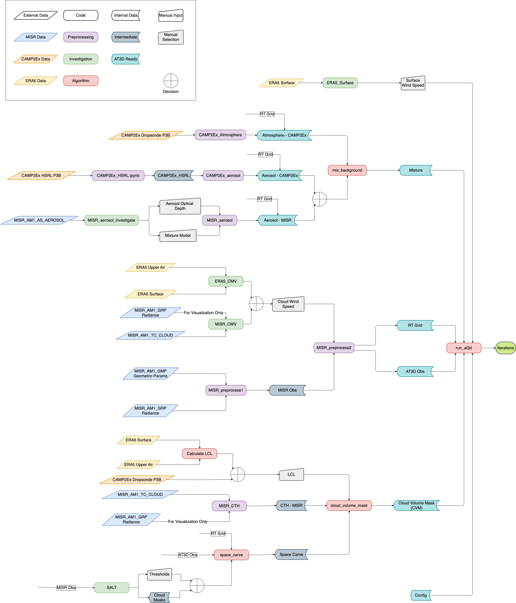

# Lundstrom2025
Lundstrom et al. (2025) will demonstrate the practical application of AT3D using a case study from CAMP2Ex and observations from MISR.

## Reproducing the manuscript

Figures from the data record (no retrievals rerun):

```bash
envs/create_envs.sh vis2 vis2_clone                           # conda envs used by the figure scripts
tar -xzf LundstromPub2025_data_record.tar.gz -C .             # data record, unpacked in the repo root
scripts/release/verify_data_record.sh                         # check the unpacked files
scripts/download/download_camp2ex.sh                          # CAMP2Ex in situ files for Fig 7
bash scripts/figures/run_figures.sh                           # all figures -> figures/manuscript/
```

- `PIPELINE.md`: rebuild every input file from raw data (`scripts/pipeline/run_pipeline.sh`), and what the
  data record contains.
- `FIGURES.md`: regenerate each figure (`scripts/figures/run_figures.sh`) and trace it to its data.
- `archive/`: code and data not used by any figure, kept at their original relative paths.

## Workflow

The following diagram describes the workflow for making an AT3D retreival using observations from MISR.



The table describes the required contents of each data file listed in the flowchart.

| Object            | Type                                         | Description                                                                 | Attribute Type  | Name               | Type      | Dimensions                                  | Description                                                                                              |
|------------------|--------------------------------------------|-----------------------------------------------------------------------------|----------------|------------------|----------|--------------------------------|----------------------------------------------------------------------------------------------------------|
| RT Grid         | xr.Dataset                                 | Base AT3D grid for radiative transfer simulation                           | Coordinate     | x                | np.array | (x)            | Equispaced and consistent with delx; starts at 0 |
|                 |                                            |                                                                             | Coordinate     | y                | np.array | (y)            | Equispaced and consistent with dely; starts at 0 |
|                 |                                            |                                                                             | Coordinate     | z                | np.array | (z)            | Should contain at least two points, be positive, and increase monotonically |
|                 |                                            |                                                                             | Data variable  | delx             | float    |                | x grid spacing |
|                 |                                            |                                                                             | Data variable  | dely             | float    |                | y grid spacing |
| MISR Obs       | xr.Dataset                                 | MISR observed single channel brf with solar and view geometry.             | Data variable  | center_lat       | float    |                | Center pixel latitude |
|                 |                                            |                                                                             | Data variable  | center_lon       | float    |                | Center pixel longitude |
|                 |                                            |                                                                             | Data variable  | SZA_center       | float    |                | Center pixel solar zenith angle (degrees) |
|                 |                                            |                                                                             | Data variable  | SAA_center       | float    |                | Center pixel solar azimuth angle (degrees) |
| AT3D Obs       | at3d.containers.SensorsDict                | Holds a dictionary of AT3D sensors, which contain wind-corrected observations along with viewing geometry, solar geometry, and wind components. | -              | -                | -        | -              | Note: "I" in this data file is (MISR Radiance) / (Solar flux on a horizontal surface) = BRF_misr * mu_0 / pi |
| CTH            | xr.Dataset                                 | Cloud top heights on a lat, lon grid.                                      | Data variable  | cth              | np.array | (y1100, x1100) | Cloud top height in meters |
|                 |                                            |                                                                             | Data variable  | lat1100          | np.array | (y1100, x1100) | Latitude of each pixel |
|                 |                                            |                                                                             | Data variable  | lon1100          | np.array | (y1100, x1100) | Longitude of each pixel |
|                 |                                            |                                                                             | Data variable  | center_lat       | float    |                | Center pixel latitude |
|                 |                                            |                                                                             | Data variable  | center_lon       | float    |                | Center pixel longitude |
| Space Carve    | xr.Dataset                                 | Carved volume.                                                             | Coordinate     | x                | np.array | (x)            | Should be consistent with the RT Grid |
|                 |                                            |                                                                             | Coordinate     | y                | np.array | (y)            | Should be consistent with the RT Grid |
|                 |                                            |                                                                             | Coordinate     | z                | np.array | (z)            | Should be consistent with the RT Grid |
|                 |                                            |                                                                             | Data variable  | mask             | np.array | (x, y, z)      | Cloud volume mask where 1 is cloudy and 0 is clear |
| Cloud Volume Mask | xr.Dataset                              | Cloud volume mask accounting for CTH, LCL, and Space Carving               | Coordinate     | x                | np.array | (x)            | Should be consistent with the RT Grid |
|                 |                                            |                                                                             | Coordinate     | y                | np.array | (y)            | Should be consistent with the RT Grid |
|                 |                                            |                                                                             | Coordinate     | z                | np.array | (z)            | Should be consistent with the RT Grid |
|                 |                                            |                                                                             | Data variable  | cloud_volume_mask | np.array | (x, y, z)      | Cloud volume mask where 1 is cloudy and 0 is clear |
| Atmosphere     | at3d.medium.optical_properteis, xr.Dataset | Valid optical properties of the atmosphere.                                | Coordinate     | x                | np.array | (x)            | Should be consistent with the RT Grid |
|                 |                                            |                                                                             | Coordinate     | y                | np.array | (y)            | Should be consistent with the RT Grid |
|                 |                                            |                                                                             | Coordinate     | z                | np.array | (z)            | Should be consistent with the RT Grid |
|                 |                                            |                                                                             | Coordinate     | table_index       | np.array | (num_micro, x, y, z) | - |
|                 |                                            |                                                                             | Coordinate     | stokes_index      | np.array | (stokes_index)  | Index of the phase matrix |
|                 |                                            |                                                                             | Data variable  | ssalb             | np.array | (x, y, z)      | Single scatter albedo between [0.0, and 1.0] |
|                 |                                            |                                                                             | Data variable  | extinction        | np.array | (x, y, z)      | Volume extinction coefficient (must be positive) |
|                 |                                            |                                                                             | Data variable  | phase_weights     | np.array | (num_micro, x, y, z) | - |
|                 |                                            |                                                                             | Data variable  | legcoef           | np.array | (stokes_index, legendre_index, table_index) | Legendre coefficients encoding the phase function |
| Aerosol        | at3d.medium.optical_properteis, xr.Dataset | Valid optical properties of aerosols.                                      | Coordinate     | x                | np.array | (x)            | Should be consistent with the RT Grid |
|                 |                                            |                                                                             | Coordinate     | y                | np.array | (y)            | Should be consistent with the RT Grid |
|                 |                                            |                                                                             | Coordinate     | z                | np.array | (z)            | Should be consistent with the RT Grid |
|                 |                                            |                                                                             | Data variable  | ssalb             | np.array | (x, y, z)      | Single scatter albedo between [0.0, and 1.0] |
|                 |                                            |                                                                             | Data variable  | extinction        | np.array | (x, y, z)      | Volume extinction coefficient (must be positive) |
| Mixture        | at3d.medium.optical_properteis, xr.Dataset | Mixed optical properties (atmosphere and aerosols).                        | Coordinate     | x                | np.array | (x)            | Should be consistent with the RT Grid |
|                 |                                            |                                                                             | Coordinate     | y                | np.array | (y)            | Should be consistent with the RT Grid |
|                 |                                            |                                                                             | Coordinate     | z                | np.array | (z)            | Should be consistent with the RT Grid |
|                 |                                            |                                                                             | Data variable  | ssalb             | np.array | (x, y, z)      | Single scatter albedo between [0.0, and 1.0] |
|                 |                                            |                                                                             | Data variable  | extinction        | np.array | (x, y, z)      | Volume extinction coefficient (must be positive) |
|                 |                                            |                                                                             | Data variable  | legcoef           | np.array | (stokes_index, legendre_index, table_index) | Legendre coefficients encoding the phase function |
